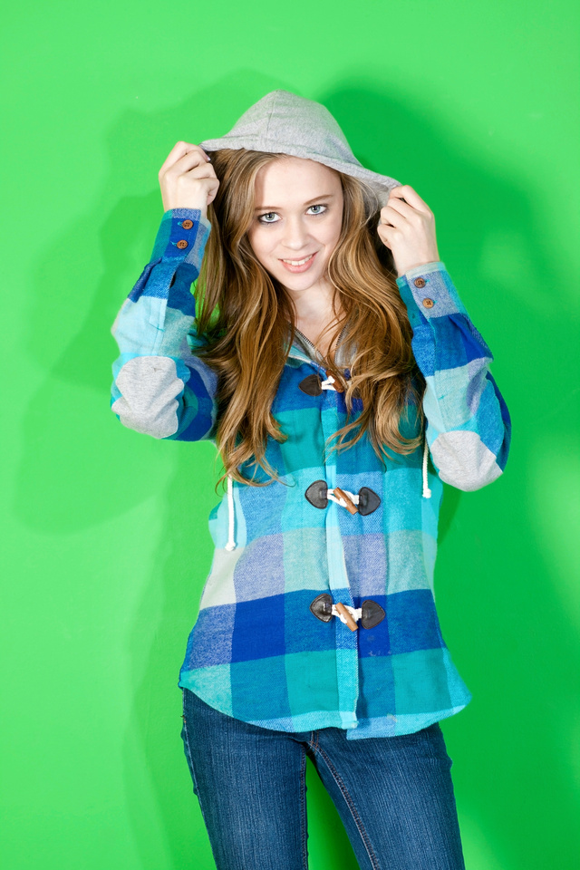
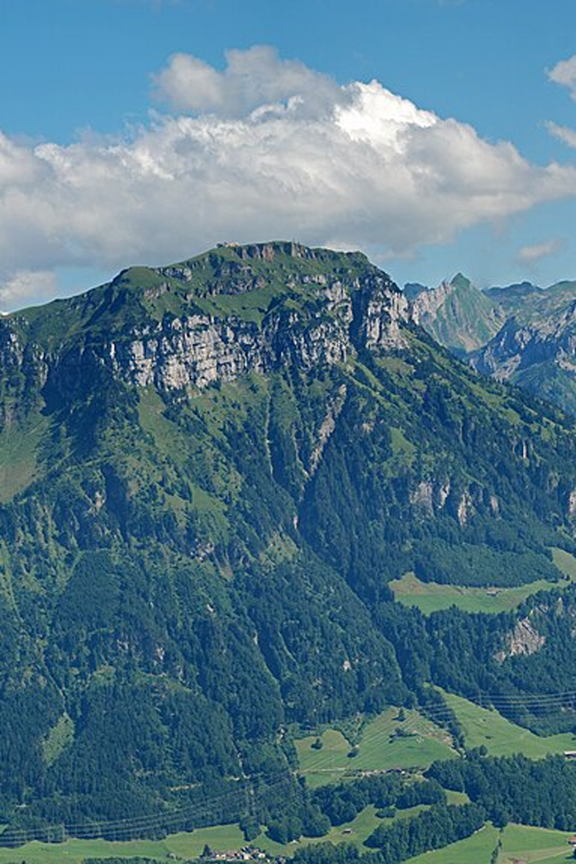
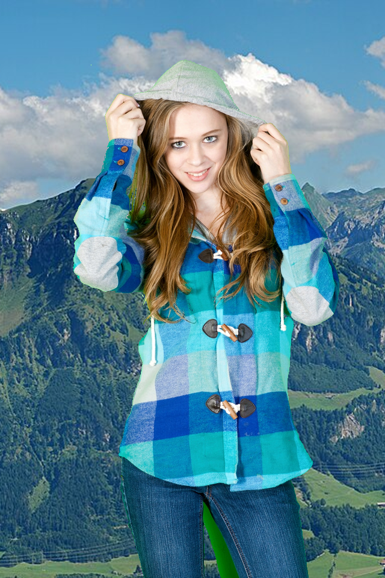
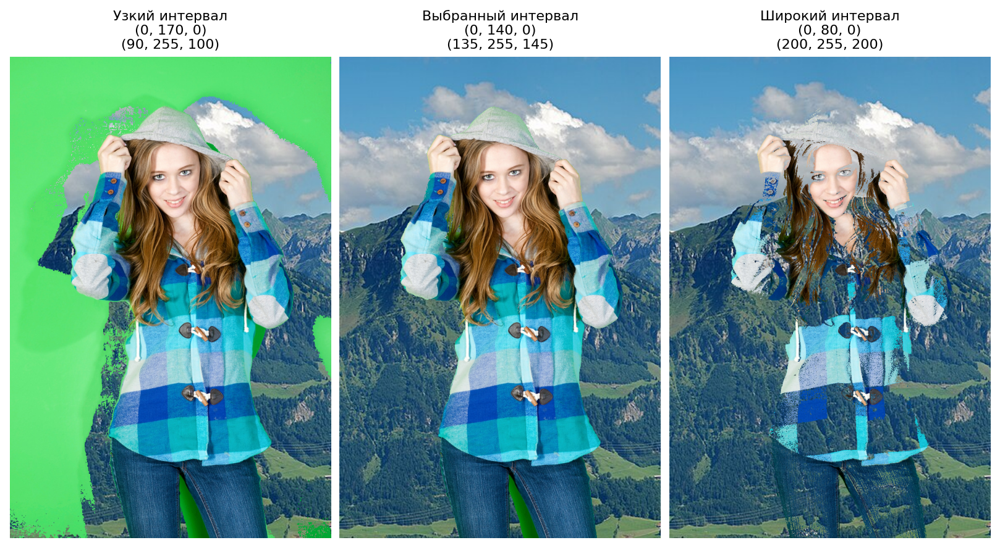
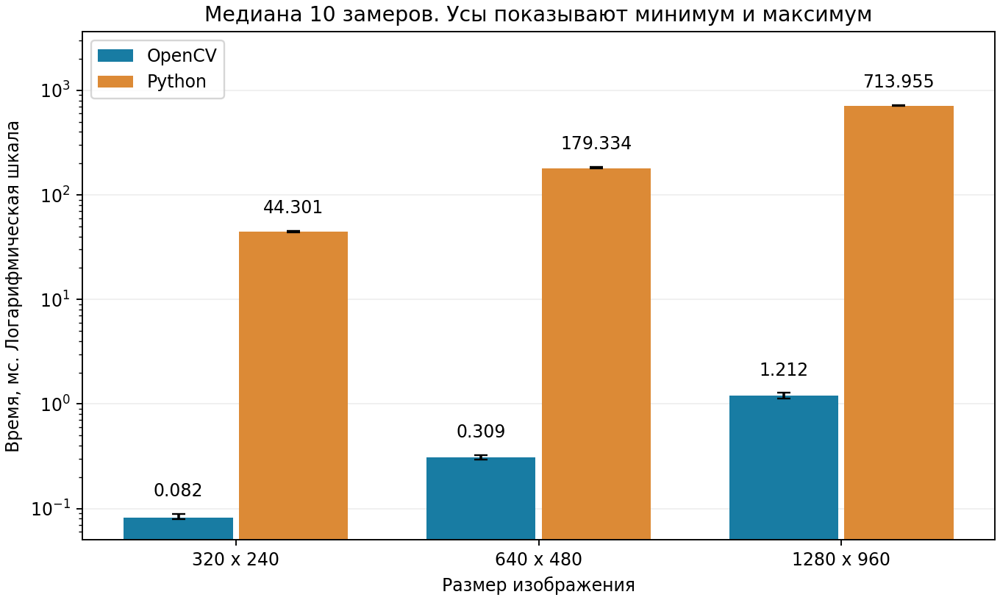

# Лабораторная работа 1. Chroma key

Трофимов Владислав Дмитриевич, P3414, ИСУ 368925. Вариант 5.

## 1. Алгоритм

Chroma key заменяет выбранные по цвету пиксели первого изображения пикселями второго с теми же координатами. Остальные пиксели сохраняются.

Пользователь задаёт нижнюю и верхнюю границы. Пиксель заменяется, только если все три канала попадают в свои интервалы. Границы включены.

Для демонстрации выбран такой диапазон.

```text
0   <= R <= 135
140 <= G <= 255
0   <= B <= 145
```

Например, `(50, 200, 70)` заменяется, а `(50, 200, 180)` сохраняется, поскольку значение B превышает 145. Время и дополнительная память алгоритма составляют O(N), где N обозначает число пикселей.

## 2. Результаты работы и проверки

Пример использует две фотографии размером 640 x 960

| Первое изображение | Новый фон | Результат |
| --- | --- | --- |
|  |  |  |

Узкий интервал оставляет часть зелёного фона. Слишком широкий захватывает одежду и волосы. Сравнение трёх интервалов показано ниже.



Проверены включённые границы, порядок RGB, полная и нулевая замена, ошибочные входы, сохранность оригиналов и равенство двух реализаций. На демонстрационной фотографии результаты также совпадают.


После двух прогревов проведено 10 замеров с чередованием порядка реализаций. Время измеряется через `perf_counter`, включая проверки и выделение массивов внутри ядра. Чтение, сохранение и подготовка данных исключены. Быстрые вызовы OpenCV измеряются пачками с пересчётом на один вызов. Ниже приведены медианы.

| Размер | OpenCV, мс | Python, мс | Ускорение |
| --- | --- | --- | --- |
| 320 x 240 | 0.082 | 44.301 | 539.2 |
| 640 x 480 | 0.309 | 179.334 | 581.1 |
| 1280 x 960 | 1.212 | 713.955 | 589.0 |




## 3. Выводы

Обе реализации дают одинаковый результат. OpenCV существенно быстрее благодаря обработке массивов в библиотечном коде. Время обработки растёт примерно пропорционально числу пикселей.

Качество зависит от диапазона. Алгоритм различает только цвета, поэтому может оставить тени и зелёные отражения или удалить части объекта. Сглаживание границ и распознавание объектов в эту работу не входят.

